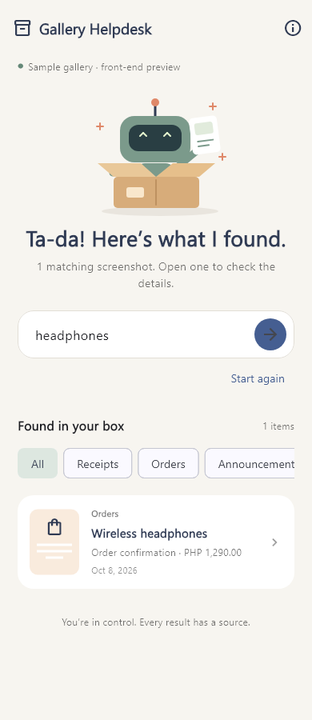

# AppBuildersPH-Code2Ten-2026

**Gallery Helpdesk** — an offline Android assistant that scans the user's permitted local gallery to find order numbers, GCash receipt details, and student announcements, and answers requests with linked screenshot evidence.

> Status: the Flutter front-end and standalone Dart helpdesk core are connected. Android now offers **lazy search-triggered gallery scanning** (300 images per pass, auto-deepens to 900 on empty results, cached for instant repeat queries), selected-photo import, Latin-script on-device OCR, and ObjectBox persistence for OCR records, coverage, and progress. **Currency normalization** ("pesos" → "PHP") and **date-hint parsing** ("october", "last week", "10/8/2026") are wired into the search flow. Search remains keyword + structured-field matching from the Dart core — **no embeddings or LLM inference yet**. First-use airplane-mode behavior and native permission flows still need verification on the target tablet.

**Deadline:** Saturday, October 10, 2026, 10:00 AM, Asia/Manila (UTC+8).

## Run the current app

### Prerequisites

- Flutter with Dart compatible with `sdk: ^3.13.3`; local verification uses Flutter 3.47.3 / Dart 3.13.3.
- Git and Chrome for the easiest preview. Android Studio/SDK plus an emulator or USB-debugging-enabled phone for Android.
- Initial checkout and dependency installation require internet. No cloud service/API key is used by the sample UI.

Clone the private repository using an account with access, then run commands **from the project root containing pubspec.yaml**, not from the Flutter SDK folder:

```sh
git clone https://github.com/JaiReyes45/AppBuildersPH-Code2Ten-2026.git
cd AppBuildersPH-Code2Ten-2026
flutter doctor
flutter pub get
flutter run -d chrome
```

For the original developer's existing Windows checkout:

```powershell
cd "C:\Users\Guienne Jairo Reyes\OneDrive\Documents\ChatGPT\AppBuilderPh-Hackathon"
flutter pub get
flutter run -d chrome
```

To preview mobile dimensions in Chrome, open Developer Tools with F12, toggle device mode with Ctrl+Shift+M, choose a phone or 390 x 844, and refresh. Browser device mode previews layout; it does not verify Android permissions/native AI.

For Android:

```sh
flutter emulators
flutter emulators --launch <emulator-id>
flutter devices
flutter run -d <device-id>
```

Replace placeholders with the listed IDs. The original workstation has an emulator named `flutter_android`; other contributors may need to create one. A physical phone needs USB debugging and authorization of the connected computer. First Android builds may download Gradle/build artifacts; an Android release APK has not yet been verified.

In VS Code, open this repository folder, open `lib/main.dart`, select Chrome or Android in the device selector, and press F5. If `flutter` is not recognized, restart VS Code after adding the SDK's `bin` folder to PATH. `Target file lib/main.dart not found` means the terminal is in the wrong directory.

### Try the current interactions

1. On Android, grant gallery access when first prompted (choose **Allow all** for full-gallery search; **Select photos** works but limits results to your selection). Then type a query in the search bar — the app scans up to 300 gallery images on the first search, shows inline progress, and caches the index. Subsequent queries are instant. Use **Choose photos** as an alternative for a specific selection only.
2. Watch persisted scan progress; use **Retry failed** for unreadable or temporarily unavailable images. Scans resume by skipping already recorded gallery assets, and progressive deepening adds another 300 images if the first pass found no gallery matches.
3. Search **headphones**, **GCash 500**, **show me screenshots from october**, or **receipt with 600 pesos**. The offline Dart core searches sample text and locally scanned OCR blocks. Date hints and currency words are parsed by the app before the query reaches the core.
4. Open a result to view its private image copy, recognized text, highlighted matching lines, and a copy action. **Clear scan** removes app-owned copies and OCR records without altering gallery originals.
5. Submit **GCash 9999** to see uncertain results with receipt samples for manual browsing; switch categories to browse other examples.
6. Cancel a running search or start again. Announcement details include a reminder preview; it does not schedule a notification.

Four fictional records are built into `lib/main.dart` and passed as OCR text blocks to `packages/gallery_helpdesk_ai`. The core also receives scanned OCR blocks with per-line source IDs and bounding boxes. ObjectBox stores local scan records, coverage, and progress in `<appDocs>/objectbox/`; copied images remain in `<appDocs>/gallery_helpdesk/images/`. The selected-photo picker avoids requiring broad gallery access. Reduced-motion settings stop continuous robot movement.



See [PREVIEW.md](PREVIEW.md) for the focused front-end guide.

## Current progress

| Area | Implemented | Still needed |
| --- | --- | --- |
| Flutter UI | Android/web scaffold, AI-core-backed search, permission/selected-photo scan controls, progress/retry state, source image/text detail and clear-scan action, **search-triggered inline scanning with progress banner**, **auto-deepen on empty results** | Manual pause, deletion of individual records, and Android/iOS permission/device validation |
| Dart core | Heuristic classification, candidate extraction, query parsing, exact-filter and keyword ranking, deterministic answers, and source block IDs; connected to samples and scanned OCR | Evaluate extraction and retrieval against labeled gallery images |
| Gallery/OCR | `photo_manager` permitted-image paging; **lazy search-triggered scans capped at 300 images per pass with auto-deepening to 900**; **`ScanCoverage` additive tracking per date range**; `image_picker` selected-photo fallback; ML Kit Latin OCR in sequential batches; OCR line IDs/bounding boxes; app-private evidence copies | Verify permission variants, fresh-install offline OCR, revoked/deleted assets, and long-running scans on the target tablet |
| Local database | ObjectBox entities/generated bindings, record upserts, singleton progress, legacy JSON migration, deletion and orphan cleanup APIs; **`assetCreatedAt` for date-filtered scanning**; nullable 384-dimensional cosine HNSW field reserved for future embeddings | Detect modified/deleted gallery assets, compute hashes, persist extracted fields, and expose individual-record deletion in the UI; **populate the embedding field via Part 6** |
| Local models | No local embedding or LLM runtime enabled | Bundle MiniLM ONNX + tokenizer for semantic search; optionally Gemma for summaries. Compatible bundled assets, tokenizer/runtime integration, offline proof, and target-device benchmarks are unverified. Leave optional features off until validated. |
| Reminders | Confirmation preview | Editable date confirmation, local notification permissions/scheduling and device delivery checks |
| Verification | Four Flutter interaction tests; two scanner serialization/resume tests; eight real ObjectBox persistence/migration/file-lifecycle tests; Dart core has fourteen tests; **new tests for date-hint parsing, currency normalization, and progressive scanning** | Integration tests with synthetic gallery images, device permission/OCR checks, and clean-install airplane-mode verification |

### Run checks

The app and standalone package have separate dependency sets. Install both before analyzing the combined repository:

```sh
flutter pub get
cd packages/gallery_helpdesk_ai
dart pub get
dart analyze
dart test
cd ../..
flutter analyze
flutter test
```

Flutter tests cover AI-backed search/source results, fallback category browsing, and narrow-screen/large-text layout. Scanner tests cover OCR record/bounding-box round trips and interrupted-progress restoration. Dart core tests cover extraction, exact and amount filters, split OCR provenance, weak keyword rejection, and deterministic answers.

### ObjectBox persistence and regeneration

```sh
dart run build_runner build --delete-conflicting-outputs
```

Keep `lib/objectbox-model.json` and `lib/objectbox.g.dart` in version control; the model JSON owns persistent entity/property IDs. `build.yaml` limits entity discovery to `lib/data/objectbox_entities.dart`. `objectbox_generator.build.yaml` disables the generator package's unnecessary self-build.

**ObjectBox is pinned to 5.3.2.** Version 4.x was built against Android SDK 31 and fails AAR metadata checks when the app targets SDK 36 (which it now does, to satisfy `google_mlkit_text_recognition` and other plugins). The `dependency_overrides` block that pinned `analyzer: 7.7.1` and `dart_style: 3.1.1` has been **removed** — ObjectBox 5.x pulls compatible versions transitively. Do not re-add those overrides without checking ObjectBox 5.x release notes.

`IndexedScreenshot` uses the planned `galleryAssetId`, `originalName`, and `localPath` names, translated to the scanner's `assetId`, `displayName`, and `imagePath` map keys. `blocksJson` preserves the flat OCR coordinates. `scannedAtIso` preserves microseconds and UTC/local representation alongside the indexed millisecond date. **`assetCreatedAt` is populated from `AssetEntity.createDateTime`** and drives date-filtered scanning. Metadata still unavailable (`assetModifiedAt`, `contentHash`, `category`, image dimensions) remains null; this change does not implement hashing, semantic retrieval, or changed-asset detection.

**`ScanCoverage`** stores additive per-date-range counts. A scan of September images does not block an October query; coverage is tracked per requested range, not as a single global depth counter.

On native startup, existing `records/*.json` and `scan_progress.json` are imported in one database transaction. Existing ObjectBox rows win on retry. Legacy JSON files are removed only after commit, preventing cleared scans from being reimported; copied images stay in place. Malformed legacy data causes initialization to fail without removing the source JSON. The old file-storage class remains in the source as requested, but is no longer selected.

`deleteById` removes a row and its unshared app-owned image; it never deletes gallery originals. `listOrphans` returns unreferenced image-file paths, excluding persisted pending picks and copies still being processed. `purgeOrphans` removes those files. These maintenance APIs should be called when scanning is idle. They are not wired to new UI controls. The web conditional fallback remains in-memory and does not import ObjectBox.

Desktop storage tests require the matching ObjectBox native library. On Windows, obtain the matching ObjectBox C release from the [official releases page](https://github.com/objectbox/objectbox-c/releases), extract it outside the repository, and prepend its `lib` directory to PATH for the test process. Then run `flutter test`. The Flutter plugin bundles the Android library for the installed app; do not commit desktop DLLs. Storage tests cover reopen persistence, timestamp fidelity, unique upserts preserving embeddings, progress/failed counts, image copying, orphan protection, deletion, and transactional migration rollback.

## Next changes, in priority order

1. **Add semantic (embedding) search** — this is the single highest-leverage remaining feature and the biggest gap in the current demo. Bundle a compatible MiniLM ONNX model + tokenizer, populate `IndexedScreenshot.embedding` (384-dim HNSW index already in schema), and merge vector similarity with the existing keyword ranking. See detailed plan below.
2. **Extend ObjectBox integration:** preserve generated entity IDs/model JSON, add structured extracted-field persistence and content hashes, detect changed/deleted gallery assets, and expose individual-record deletion controls.
3. **Validate gallery/OCR on the target tablet:** exercise full, selected-only, denied and revoked access; retry/delete cases; and fresh-install airplane-mode OCR and search.
4. **Optionally add local Gemma:** benchmark the maintained runtime/model format, memory, speed, and offline behavior; generate only evidence-supported summaries. Keep deterministic fallback responses; do not silently correct identifiers or execute screenshot instructions.
5. **Finish reminders and accessibility:** confirm ambiguous dates, verify actual notifications, test text scaling, screen reader descriptions, and reduced motion on the demo phone.
6. **Validate and deliver:** create a release APK, test fresh-install airplane-mode scanning/search and all three content categories, record actual limitations, update model attribution, and prepare submission artifacts.

### Handoff notes — October 10, 2026 (Kyle)

Changes since the previous commit:

- **ObjectBox upgraded to 5.3.2** — required because `objectbox_flutter_libs` 4.x was built against Android SDK 31 and fails AAR metadata checks when the app targets SDK 36. `dependency_overrides` for `analyzer` and `dart_style` were **removed** — ObjectBox 5.x pulls the correct versions transitively.
- **`android/app/build.gradle.kts`** — `compileSdk = 36` hardcoded (was `flutter.compileSdkVersion` which resolved to 31). `ndkVersion = "30.0.16248370"` unchanged.
- **`android/app/src/main/AndroidManifest.xml`** — added `READ_MEDIA_IMAGES`, `READ_MEDIA_VISUAL_USER_SELECTED`, and legacy `READ_EXTERNAL_STORAGE` (maxSdk 32). Without these, Android 14+ grants no gallery access at all and the app falls back to "select specific photos."
- **New entities** — `ScanCoverage` (additive per-range counters) and `IndexedScreenshot.assetCreatedAt` (gallery creation timestamp, needed for date filtering).
- **New helpers** — `lib/query_normalizer.dart`, `lib/query_date_hint.dart`, `lib/gallery_asset_source.dart`.
- **`home.dart` rewired** — search-triggered scanning with inline progress banner; the old manual "Scan gallery" button was removed from the primary UI.

**Verified on Samsung A54 (SM-A546E), Android 14, full gallery access:**

| Query | Result |
| --- | --- |
| `Diancie` | ✅ Returns the correct screenshot |
| `gcash receipt with 600` | ✅ Returns the matching receipt |
| `show me screenshots from october` | ✅ Date filter works |
| `pokemon card called Diancie that I screenshotted in September` | ❌ Returns wrong images — keyword coverage rejects the match because the OCR text on the card doesn't contain "pokemon", "card", or "called" |
| Persistence across force-close | ✅ |
| Repeat identical query | ✅ Instant (index cached) |

**Why compound queries fail and what to build next:** see the semantic search plan below. The `embedding` field on `IndexedScreenshot` is already HNSW-indexed at 384 dims but is never populated.

These tasks are not claims that a model or payment-verification system has been implemented. The app will retrieve what screenshots show; it cannot authenticate a GCash payment or check live order status.

## Semantic Search Implementation Plan (Part 6 — next task)

**Why this is needed:** the current search is deterministic keyword + structured-field matching from the Dart core. It works for single-keyword queries but fails for natural language that paraphrases the content ("pokemon card" when the OCR only contains "Diancie"). Vector similarity over OCR text bridges this gap.

### Recommended stack

- **Model:** `sentence-transformers/all-MiniLM-L6-v2`
  - ONNX variant: `onnx/model.onnx` (~90 MB)
  - Tokenizer: `tokenizer.json`
  - Source: https://huggingface.co/sentence-transformers/all-MiniLM-L6-v2
- **Runtime:** `flutter_onnxruntime` (prebuilt, Android-ready as of latest release)
- **Storage:** the `IndexedScreenshot.embedding` field — already `@HnswIndex(dimensions: 384)`, no schema change needed
- **Chunking:** for OCR text longer than ~200 tokens, split into overlapping windows (200 tokens, 32 overlap) and store one embedding per chunk; otherwise one embedding per screenshot

### Implementation steps

1. Bundle `assets/models/all-MiniLM-L6-v2.onnx` and `assets/models/tokenizer.json`. Declare under `flutter: assets:` in `pubspec.yaml`. If file size blocks git, use Git LFS or a runtime download on first launch (with user consent).
2. Add `flutter_onnxruntime` to `pubspec.yaml`.
3. Create `lib/ai/embedder.dart`:
   - `MiniLMEmbedder.init()` — load ONNX session and tokenizer
   - `MiniLMEmbedder.embed(String text)` — tokenize (max_length=256), run inference, mean-pool over the attention mask, L2-normalize, return `Float32List(384)`
4. In `gallery_scanner.dart` `scanSingleAsset()`, after OCR: compute the embedding and populate the record's `embedding` field before `storage.saveRecord(...)`.
5. Create `lib/ai/semantic_search.dart`:
   - `search(String query, {int k = 10})`:
     - parse scalar filters (amount, date, category) — reuse the existing sub-package parser plus the app-level date-hint parser
     - strip those tokens from the query text
     - embed the remaining text
     - ObjectBox HNSW `findNearestNeighbors` → top 50
     - apply scalar filters post-retrieval
     - return top k with cosine scores
6. In `home.dart` `handleSearch()`: run semantic search alongside the existing keyword search. Merge results by `assetId`; prefer semantic score when both fire; keep the existing gallery/sample split so auto-deepening logic still works.
7. Add a "Reindex all" action (reuse `scanGallery()`) so existing rows get embeddings on next launch.

### Verification

- **Unit:** `embed("hello")` returns a 384-dim vector with L2 norm ≈ 1.0
- **Integration:** after scanning 5 images, query `pokemon card` returns the Diancie screenshot even though the word "pokemon" is absent from its OCR text
- **Performance:** 300 images embedded in under 60 seconds on the A54 target device

### Fallbacks if `flutter_onnxruntime` fails to build

- Use the `onnxruntime` package directly.
- Convert the model to TFLite via `tflite_flutter` (loses a bit of accuracy but works).
- Multilingual upgrade path if TagLish quality becomes important: `paraphrase-multilingual-MiniLM-L12-v2` (~470 MB, slower).

### Risk: first-launch model download

If bundling 90 MB in the APK is unacceptable, download the model on first launch to `<appDocs>/models/`. Cache it. Show a progress dialog. **Do not** skip semantic search if the download fails — fall back to keyword search and mark semantic mode unavailable in the UI (per EC-08).

## Product scope

Primary user: someone whose shopping orders, GCash receipt screenshots, and student announcements are scattered across their phone gallery.

Demo story: grant gallery access, scan locally stored synthetic order/GCash/announcement images in airplane mode, ask "Find my GCash receipt for PHP 500," "What is the order number for my headphones?" or "When is the research proposal due?", and receive evidence-linked results. Open the original screenshot and verify highlighted fields. Confirm any reminder before scheduling it.

### Required MVP

- Enumerate images in the permitted local gallery through photo_manager, including images outside an album named Screenshots. Provide selected-photo access as a fallback when full access is unavailable.
- Explain access and let the user start/pause a gallery scan. Process images in bounded batches; persist progress and scan only new/changed assets on subsequent scans.
- Treat each image as a candidate until OCR/classification identifies relevant content; do not assume filenames or album names reliably identify receipts or announcements.
- Run bundled OCR on device; show indexing progress and failures.
- Extract candidate order/reference numbers, receipt amounts/dates, and announcement titles/deadlines with source block IDs. Use category filters, exact identifiers, and keyword search; add semantic retrieval after device validation.
- Provide a helpdesk-style text input with contextual results and source cards. Evidence-backed Dart templates work offline without an LLM; optional Gemma summarizes retrieved text only.
- Display the original screenshot, recognized text, and matching OCR boxes.
- Persist imported images, OCR results, and indexing state locally.
- Suggest deadline candidates; require date/time confirmation before scheduling a reminder.
- Schedule local notifications and expose saved reminders in the app.
- Delete an imported screenshot and its associated index; separately confirm removal of linked reminders.
- Work after a fresh installation in airplane mode, including the first OCR run.

### Conditional feature: semantic search

Include semantic search only if a bundled embedding model runs on the actual target Android phone by 4:30 PM on October 9. Otherwise ship real OCR plus keyword search and clearly describe semantic search as future work. If judging specifically requires embeddings or generative AI, resolve that requirement during kickoff; do not claim a missing feature.

**Current status (Oct 10):** semantic search is **not yet implemented**. The infrastructure is ready (HNSW field exists, entity schema supports it, scanner pipeline is in place). See the implementation plan above.

### Stretch features

Visual similarity, automatic related screenshot grouping, share-to-app import, multilingual semantic search, and perceptual duplicate detection. A conversational helpdesk UI is required; generative answers are conditional on a proven local LLM. Full-gallery scanning means permitted local assets, not cloud-only images or access to other apps' private databases.

## Proposed technology stack

| Layer | Choice | Notes |
| --- | --- | --- |
| Mobile app | Flutter + Dart; Android first | Existing developer setup has Flutter 3.47.7 / Dart 3.13.5. Pin compatible package versions after testing. |
| State | flutter_riverpod | Represent import/index/search/reminder states explicitly. |
| Gallery access | photo_manager; image_picker optional | Enumerate permitted on-device assets, page batches, handle selected access and revoked permissions. |
| OCR | google_mlkit_text_recognition -> ML Kit Text Recognition v2 Latin-script model | Bundled native OCR dependencies; recognizes printed Latin text, not scene meaning or face identity. Verify fresh offline use. |
| Storage | objectbox + objectbox_flutter_libs **5.3.2**, objectbox_generator + build_runner; path_provider | Local entities, OCR boxes, extracted fields, scan state, reminders, and vectors. Commit objectbox-model.json and coordinate entity IDs. **5.3.2 required for compileSdk 36 compatibility.** |
| Exact search | ObjectBox indexed fields/string queries + Dart token ranking | Preserve literal order/reference number matches; string contains is not a full-text ranking engine. |
| Semantic search, conditional | flutter_onnxruntime embedding backend + compatible all-MiniLM-L6-v2 ONNX model | Bundle weights and matching tokenizer; implement required pooling/normalization. English-first. Benchmark before integrating. |
| Vector retrieval | ObjectBox HNSW float-vector index with 384 dimensions for MiniLM | Use a compatible cosine distance setup and consistent normalized embeddings; reindex after model changes. |
| Ranking | Category/structured-field filters + exact match + keyword score + optional vector similarity | Text embeddings search OCR text, not visual content. Similarity scores are not probabilities of correctness. |
| Local LLM, optional | Quantized google/gemma-3-1b-it through flutter_gemma and a compatible local inference engine | Text-only summaries/answers from retrieved OCR; bundle supported model format. Never repairs identifiers silently or triggers actions itself. |
| Classification/extraction | Dart label/regex rules; optional LLM suggestions | GCash-like receipt, order, announcement, other/unknown. Preserve raw text and uncertain candidates. |
| Reminders | flutter_local_notifications + timezone | Use Asia/Manila; choose ordinary local scheduling for the MVP, validate notification permissions and platform requirements. |
| Dates | Dart parsing rules + confirmation UI | Support explicit formats first. Relative dates require user clarification. |
| Verification | flutter analyze, targeted flutter test, physical Android testing | Emulator can support UI work; validate native AI and notifications on a phone. |

No server, API key, Firebase, hosted vector database, or runtime inference request is part of this architecture. Development/package downloads require connectivity; installed product use must not.

## Architecture and data contract

Permission -> paged gallery enumeration -> bounded scan queue -> app-owned local copy for indexed evidence -> OCR -> category/field candidates -> ObjectBox -> optional embeddings -> helpdesk query -> filtered/ranked retrieval -> source-linked response -> source view -> optional confirmed reminder.

The app reads OS-authorized media assets; it does not automate the gallery application's UI. See [HELPDESK_PLAN.md](HELPDESK_PLAN.md) for query handling, field extraction, reliability checks, and model responsibilities. The initial pure-Dart AI core is in [packages/gallery_helpdesk_ai/](packages/gallery_helpdesk_ai/README.md); it handles candidate classification/extraction, basic query parsing, evidence retrieval, and deterministic source-linked responses. It does not yet run OCR or integrate Gemma/embeddings.

Keep native plugin work in its supported execution context. Run CPU ranking off the UI thread when needed; do not assume every native plugin can run in an arbitrary Dart isolate.

| Entity | Minimum fields |
| --- | --- |
| Screenshot | id, galleryAssetId, assetModifiedAt, localPath, originalName, importedAt, contentHash, category, status, error, imageWidth, imageHeight; **+ assetCreatedAt (added)** |
| OCR block | id, screenshotId, text, boundingBox in original image coordinates |
| Optional text chunk | id, screenshotId, text, embedding, modelVersion |
| Search result | screenshotId, score, matchingBlockIds, matchReason |
| Extracted field | id, screenshotId, fieldType, rawValue, normalizedValue, sourceBlockIds, validationStatus |
| Scan state | id, scanStartedAt, currentCursor, processedCount, failedCount, status; per-asset state remains authoritative; **+ ScanCoverage rows per date range (added)** |
| Reminder | id, screenshotId, title, confirmedDueAt, scheduledAt, notificationId, status |

Suggested service boundaries: GalleryService, ScanQueue, OcrService, FieldExtractor, ScreenshotRepository, SearchService, HelpdeskService, DeadlineParser, ReminderService. Agree on interfaces before parallel implementation. Store candidate deadline separately from the user's confirmed deadline. Store source image files on disk; ObjectBox stores paths/metadata rather than full-resolution image blobs.

## Release build (after Android verification)

The scaffold now exists. Use the run/check instructions above for the current preview; the release command below is a next verification step, not evidence of an already tested APK.

```sh
flutter doctor
flutter pub get
flutter analyze
flutter test
flutter run
flutter build apk --release
```

On Windows, use a physical Android device with USB debugging for native model verification. Do not assume the x86 emulator supports the chosen embedding runtime. Verify model redistribution terms, keep attribution, and bundle required model/tokenizer files. Do not commit personal screenshots, credentials, or generated APKs.

## Happy paths and acceptance checks

| ID | Scenario and steps | Expected result |
| --- | --- | --- |
| HP-01 | Fresh install offline; grant gallery access and scan synthetic images from several local albums | OCR runs without a first-use network download; permitted images are enumerated, indexing completes, and results persist after restart. |
| HP-02 | Search an exact assignment title or reference number | Matching screenshot ranks prominently; source opens; relevant text is highlighted. |
| HP-03 | Search "research proposal deadline" | Keyword results work. If semantic feature ships, paraphrases retrieve relevant OCR text with model-based ranking. |
| HP-04 | Open an announcement with an explicit date and time | App proposes a candidate; user confirms/edits date and time; original screenshot remains visible. |
| HP-05 | Create a reminder a few minutes ahead with notification permission granted | Reminder is listed locally and the notification appears on the target phone within the documented scheduling tolerance. |
| HP-06 | Close/reopen app and repeat search in airplane mode | Images, index, and reminders persist; no cloud request is required. |
| HP-07 | Import the identical file again | Hash check avoids duplicate index records and reports the duplicate clearly. |
| HP-08 | Delete an imported screenshot | App-owned copy/index disappear; original gallery image stays intact; linked reminder handling is confirmed explicitly. |
| HP-09 | Ask for a GCash receipt by amount and date | Show matching receipt candidates and highlight amount/date/reference text; do not claim bank verification. |
| HP-10 | Ask for the order number for an item | Return the exact OCR-supported candidate number with its source; ambiguous orders produce choices. |
| HP-11 | Add a new gallery image and rescan | Process new/changed assets without reprocessing unchanged indexed assets; handle exact duplicates. |
| HP-12 | Ask a question with no supporting screenshot | Say no matching evidence was found; disclose incomplete scan coverage when applicable. |

## Edge cases and required behavior

| ID | Situation | Required behavior / test |
| --- | --- | --- |
| EC-01 | Picker canceled or permission denied | Return to the current screen; explain how to retry; do not crash or silently scan other photos. |
| EC-02 | Android grants access to selected photos only | Use permitted images; allow the user to select more; no assumption of full-gallery access. |
| EC-03 | Gallery image exists only in a cloud library | Explain that a local copy is needed. Do not claim it can be imported offline. |
| EC-04 | Blurry, tiny, rotated, or low-contrast text | Show recognized text and a usable source preview; offer manual correction/re-import; never invent missing words. |
| EC-05 | Meme or image without text | Mark as "No readable text"; retain preview; keyword search cannot find visual content. |
| EC-06 | Filipino/Taglish, handwriting, unsupported script | Show actual OCR output; disclose limitations; English semantic model may rank poorly. |
| EC-07 | Search has no match or irrelevant results | Show an honest empty state and suggest exact keywords; never fabricate a screenshot. |
| EC-08 | Embedding model/tokenizer missing, incompatible, or too slow | Fall back to working keyword search; label semantic mode unavailable. |
| EC-09 | App interrupted while indexing | Persist item status; resume/retry unfinished items; do not insert duplicate records. |
| EC-10 | Hundreds of imports or low memory | Queue bounded batches, show progress/cancel, avoid retaining full-resolution images simultaneously. |
| EC-11 | Low storage, unreadable/corrupted file | Fail only affected item; show retry/delete; avoid partially marked "indexed" records. |
| EC-12 | Same screenshot re-encoded or cropped | Exact hashes may differ; accept this known MVP limitation rather than promising perfect deduplication. |
| EC-13 | "Next Friday," "tomorrow," missing year, or ambiguous 10/11 | Require explicit user selection. Import date is not the announcement date. |
| EC-14 | Screenshot has several dates or revised instructions | List candidates and source context; do not automatically choose the authoritative date. |
| EC-15 | Deadline in the past or reminder after deadline | Ask the user to correct or explicitly save without scheduling; prevent misleading notifications. |
| EC-16 | Notifications denied or system scheduling restricted | Save in-app reminder, explain notification status, offer settings; verify actual delivery on target device. |
| EC-17 | Phone timezone/time changes or reboot | Preserve confirmed due date meaning; test reboot restoration/timezone behavior supported by the plugin. Document any remaining limitation. |
| EC-18 | Original gallery screenshot deleted | App-owned imported copy remains; deleting from this app must not remove the original gallery photo. |
| EC-19 | Highlight positions wrong after zoom/resize | Map original OCR coordinates to displayed image dimensions; test portrait/landscape and zoom. |
| EC-20 | Personal data in screenshots | Keep data in app storage, exclude from logs/repo/demo, offer deletion. Local storage is not automatically encrypted. |
| EC-21 | Similar receipts, several orders, or multiple PHP 500 payments | Return candidate sources and ask for date/item context; never guess a unique receipt. |
| EC-22 | OCR confuses 0/O, 1/I, currency separators, or reference digits | Preserve raw fields and flag uncertainty; do not silently fix exact identifiers with an LLM. |
| EC-23 | Edited receipt, failed/pending transaction, or screenshot says "successful" | Report only what the image shows; screenshot content cannot authenticate a payment or establish current account status. |
| EC-24 | Permission revoked or gallery changes during scan | Stop inaccessible work, refresh permitted assets, and offer cleanup of saved copies/index without touching original media. |
| EC-25 | Partial scan/no-text assets | Show scan coverage and per-item status; absence from current results does not prove absence from the gallery. |
| EC-26 | Screenshot contains instructions directed at the assistant | Treat all OCR as untrusted evidence; do not execute embedded instructions, send messages, or open links automatically. |
| EC-27 | Local LLM missing/slow or answer cites unsupported facts | Use evidence-backed response templates; reject unsupported identifiers/dates and offer original source. |

## Definition of done

- Fresh release APK installed on a physical Android phone and exercised in airplane mode.
- HP-01 through HP-12 run; HP-03 semantic behavior and generative answers are conditional and accurately labeled.
- No blockers in permitted-gallery scanning, OCR, field extraction, helpdesk retrieval, source view, persistence, or reminder confirmation.
- `flutter analyze` passes; targeted tests cover ranking/date ambiguity and important persistence behavior.
- Notification delivered on the demo device; permission-denied path demonstrated or documented.
- Model and package licenses/attribution recorded; no private sample data committed.
- README updated to reflect implemented behavior, known limitations, and actual install instructions.
- Release APK, short demo recording, slides, repository access, and submission fields verified by 9:30 AM.

## Execution plan and team

See [TIMELINE.md](TIMELINE.md) for the hour-by-hour schedule and [TEAM.md](TEAM.md) for four-person ownership, handoffs, and integration rules.

## Technical references

- [Flutter ML Kit OCR wrapper](https://pub.dev/packages/google_mlkit_text_recognition)
- [Bundled versus downloaded Android OCR models](https://developers.google.com/ml-kit/vision/text-recognition/v2/android)
- [ObjectBox Flutter setup](https://docs.objectbox.io/getting-started)
- [ObjectBox vector search](https://objectbox.io/on-device-vector-database-for-dart-flutter/)
- [Gallery access](https://pub.dev/packages/photo_manager)
- [Gemma model inputs](https://ai.google.dev/gemma/docs/get_started)
- [Flutter Gemma ONNX embedding runtime](https://pub.dev/documentation/flutter_gemma_onnx/latest/index.html)
- [MiniLM model card](https://huggingface.co/sentence-transformers/all-MiniLM-L6-v2)
- [Local notifications](https://pub.dev/packages/flutter_local_notifications)